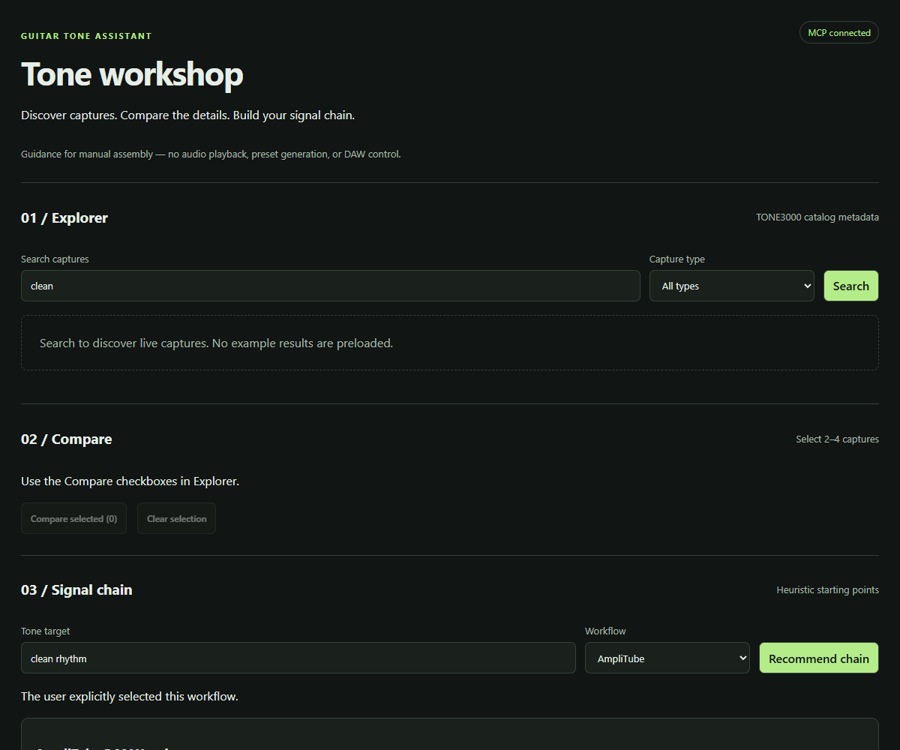

# Guitar Tone Assistant

A TypeScript MCP server for discovering TONE3000 captures, searching the 435-model AmpliTube 5 MAX v2 catalog, and assembling guitar signal chains manually. An optional React MCP App adds capture exploration, comparison, visual chains, and local rig editing.

It does not listen to audio, match recordings, control a DAW, or generate preset files. Artist references and knob values are heuristic starting points; audition with your guitar and monitoring equipment.

## Setup

Requirements: Node.js 22.12+ and npm. No Python or Git submodule is required to build or run. Optional catalog research scripts still use Python; they are not part of runtime setup.

1. Run `npm ci`.
2. Copy `.env.example` to `.env`.
3. Generate a server secret at [TONE3000 settings](https://www.tone3000.com/settings) and set `TONE3000_SECRET_KEY`. Keep this file private. The publishable key is used for future OAuth integrations, not this local server-secret flow.
4. Run `npm run build` and `npm test`.

Without a key, the local AmpliTube search and troubleshooting work; live tools report missing credentials. Recommendations can still provide offline guidance.

## Run and connect

Stdio: `npm start` (or `npm run dev` for source development). An MCP host starts this process on demand; it is not a web page or permanent Windows service.

Example host configuration; replace the paths:

```toml
[mcp_servers.guitar-tone-assistant]
command = "node"
args = ["C:/path/tone3000mcp/dist/src/index.js"]
cwd = "C:/path/tone3000mcp"
```

The working directory lets dotenv load the ignored local credential file. Restart the host after changing the build or configuration. Regular Chat does not automatically inherit a local host configuration; connecting a hosted Chat client is a separate integration.

Local HTTP: `npm run start:http` exposes `http://127.0.0.1:8787/mcp`; health is `GET /`. The transport is stateless POST. Non-loopback startup and cross-origin browser requests are rejected. It has no caller identity and must not be tunneled or publicly exposed.

## Interactive MCP App

Ask a compatible host to **open Tone Explorer** (`open_tone_explorer`). It reads `ui://guitar-tone-assistant/explorer.html`, bundled as one HTML resource with no remote assets. The View uses the official MCP Apps host bridge to invoke data tools. It never receives an API secret.

Search captures, inspect model metadata, select 2–4 captures for comparison, request one of three manual workflows, and load/edit the default local rig. Source-page buttons use the host's link-opening capability. Missing host capabilities disable interactions with a text fallback. `npm run dev:ui` is a layout preview; a normal browser alone does not supply the host bridge.

External ChatGPT/Claude host rendering has not been manually verified in this iteration. Automated tests cover the bridge wrapper, and a local browser harness validates the official bridge independently of any product account. See [development](docs/DEVELOPMENT.md) for manual host acceptance steps.



_Verified local MCP Apps browser harness. This screenshot demonstrates the interface; it does not establish external ChatGPT host compatibility._

## Tools

| Tool                   | Purpose                                                |
| ---------------------- | ------------------------------------------------------ |
| search_tone3000        | Live search and metadata ranking                       |
| get_tone3000_tone      | Capture classification and model metadata              |
| search_tone3000_cabs   | Cabinet IR discovery                                   |
| search_amplitube_gear  | Offline versioned gear catalog                         |
| recommend_tone_chain   | Explain manual TONE3000, AmpliTube, or hybrid assembly |
| compare_tones          | Compare 2–4 capture IDs or official URLs               |
| troubleshoot_tone      | Prioritized routing and tone adjustments               |
| get_user_tone_profile  | Read a local rig                                       |
| save_user_tone_profile | Replace a local rig                                    |
| open_tone_explorer     | Launch optional interactive View                       |

Examples: “Find clean amp-only captures.” “Compare these three tone links.” “Recommend an AmpliTube clean rhythm chain for single coils.” “My amp+cab capture sounds muffled through another cabinet.”

## Signal-chain rules

An amp-only NAM capture is a fixed amp snapshot and needs one cabinet/IR stage. An amp+cab capture already includes cabinet coloration: adding another cab often produces a muffled sound. Cabinet IRs color an amp output and do not replace the amp. A NAM amp model cannot go in an IR loader.

TONE3000/NAM: download an accessible model through TONE3000 and load it in a compatible player; add a cab only when needed. AmpliTube: assemble the suggested amp/cab/effects manually and use only controls actually present on that model. Hybrid: AmpliTube amp → TONE3000 WAV cabinet IR in a compatible IR loader → post effects; disable the regular cabinet stage. Generic knob values do not imply every catalog model has those controls.

The catalog's inventory membership is sourced from IK's MAX v2 inventory. Detailed control/tone metadata is richer for the curated subset; unknown hardware mappings remain unknown. See the research evidence under docs/research.

## Tone-quality evaluations

Run `npm run eval:tones` for 24 deterministic checks of recommendation intent and signal-chain safety. These do not assess the sound: use the [listening evaluation guide](docs/EVALUATIONS.md) and [feedback template](docs/LISTENING_EVAL_TEMPLATE.md) to record real audition results. `npm run test:live` is a separate optional authenticated API smoke test. CI runs the deterministic checks without credentials.

## Development and limitations

Commands: `npm run build`, `npm run build:server`, `npm run build:ui`, `npm run typecheck`, `npm test`, `npm run test:browser`, and `npm audit`.

Verification for this revision: backend/UI builds and typecheck passed, all 41 automated tests passed, and the installed-Chrome browser harness passed. The harness checks the official host bridge, initial tool data, real backend calls, narrow layouts, and painted screenshot content so a blank raster cannot silently pass. `npm run test:browser` requires Google Chrome installed and a completed `npm run build`. Screenshots are saved under `.cache/browser-checks/`.

API responses are validated before caching. Requests time out and surface 401/403/429/5xx safely without automatic retry storms. Profiles validate data, reject reserved IDs and serialize atomic writes within one process; multiple processes must not share a writable file. Saved profiles influence View recommendations after loading; ordinary recommendation callers must pass their rig explicitly.

Preset generation was removed in 0.3.0, including its compiler, gitlink, Python adapter, environment options and download route. `deliveryKind: tone3000-preset` became `tone3000-instructions`; other core tool names are retained. Existing user-generated files were preserved outside the runtime.

- [Architecture audit](docs/ARCHITECTURE_AUDIT.md)
- [Architecture and protocol diagrams](docs/ARCHITECTURE.md)
- [Development and verification](docs/DEVELOPMENT.md)
- [Deployment requirements and blockers](docs/DEPLOYMENT.md)
- [Execution checklist](docs/IMPLEMENTATION_PLAN.md)

Local experimentation is supported. Shared hosting requires caller authentication, per-user TONE3000 OAuth, profile isolation, and policy review before deployment.
