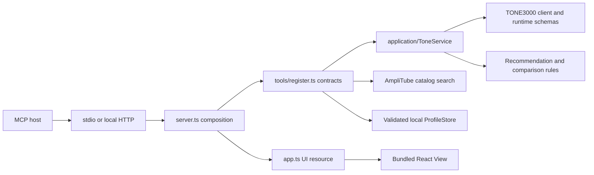
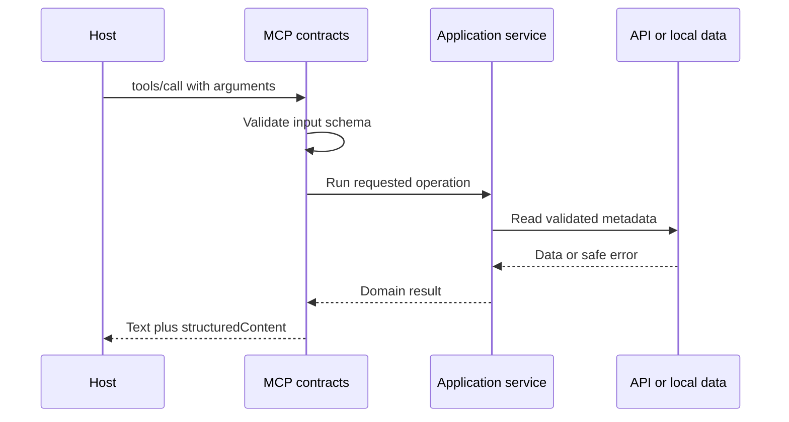
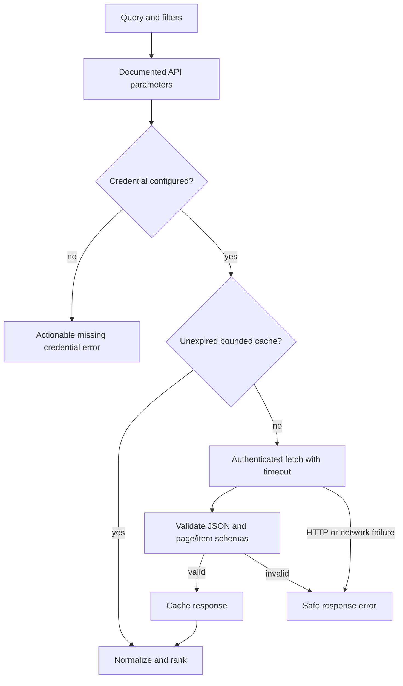
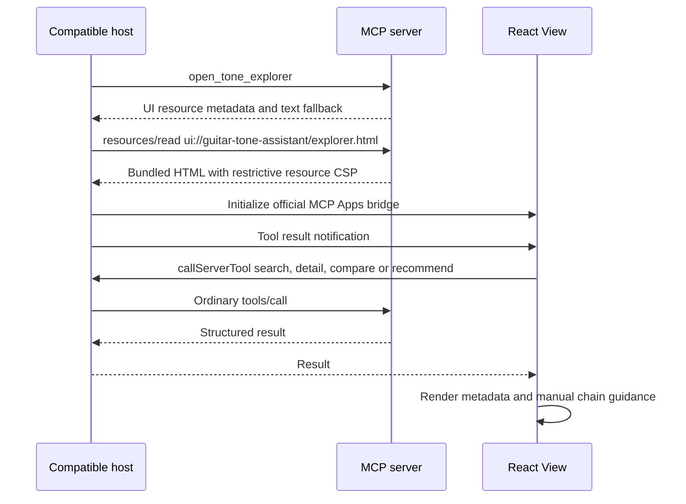

# Architecture

The same tools serve stdio and stateless local HTTP. The View contains presentation state, not a second recommendation engine.

## Tool lifecycle

## Search

Metadata relevance and community indicators produce deterministic rankings. They do not establish recording similarity. Amp-only, amp+cab, and cabinet IR classification drives routing; unknown stages require confirmation. Comparison gain/EQ descriptions are labeled hypotheses.

## UI interaction

The launch tool alone references a View. Data operations do not create new iframes. React escapes untrusted text; only HTTPS TONE3000 URLs can be opened. No protected API fetch occurs in the iframe. Rig writes require explicit Save; existing supported fields are retained. The View does not fetch a profile on mount.

## Dependency decision

ext-apps 1.7.5 supports the existing MCP SDK 1.x and Zod 3/4 peers. It is pinned to avoid silently introducing SDK 2.x; current 2.x documentation states wire compatibility. Zod was upgraded to 4.6.7 for a security advisory, with generic schema types adapted and regression tests run. Vitest moved to 5.1 for patched worker dependencies, raising the development/runtime baseline to Node 22.12. The lockfile resolves one MCP SDK (1.32.2) and one Zod. Vite bundles React, bridge code and CSS into one HTML document.

Official references reviewed: [MCP Apps](https://apps.extensions.modelcontextprotocol.io/api/), [official repository](https://github.com/modelcontextprotocol/ext-apps), [OpenAI UI guidance](https://developers.openai.com/plugins/build/chatgpt-ui), [quickstart](https://developers.openai.com/plugins/build/app-quickstart), [Zod migration](https://zod.dev/v4/changelog), [Vitest migration](https://vitest.dev/guide/migration/).

## Files

src/server.ts composes tools and resource registration. src/tools/register.ts retains public MCP schemas and formats results. src/application/tone-service.ts orchestrates discovery/detail/comparison/recommendations. src/tone3000 contains HTTP/cache/schema/normalization boundaries. src/recommendation contains deterministic heuristics. src/amplitube and src/data provide the offline catalog. src/profile provides schemas and serialized atomic persistence. src/http-server.ts owns local request guards and cleanup. ui contains the React View and tests. dist is generated and ignored.
