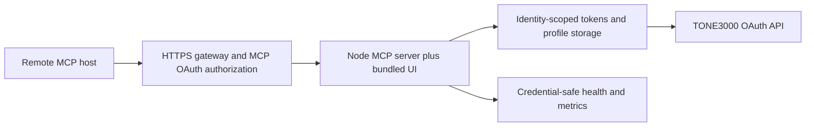

# Deployment planning — no deployment performed

The implemented HTTP server is deliberately local-only. Do not expose it with a public tunnel or reverse proxy. The server has no MCP caller authentication or multi-user identity. The existing server-wide TONE3000 secret and local rig store are for one trusted local user.

## Future architecture

This diagram describes required future components, not implemented remote functionality.

## Build and assets

npm ci → npm run typecheck → npm test → npm run build. Ship dist, package manifests and production dependencies together. dist/ui/index.html is a self-contained resource served over MCP resources/read, not a public asset URL. It has no runtime CDN dependencies. Keep all paths relative to modules except configurable local profile storage. No Dockerfile is added because no container deployment has been selected or tested.

## Local configuration

TONE3000_SECRET_KEY is server-only. TONE3000_API_BASE_URL defaults to the official HTTPS v1 API. TONE3000_TIMEOUT_MS defaults to 12000; cache TTL defaults to 300 seconds. HOST defaults to 127.0.0.1 and startup rejects non-loopback values. PORT defaults to 8787. PROFILE_STORE_PATH defaults to .cache/user-profiles.json. Do not inject secrets into VITE_* variables or HTML.

## Remote blockers and security requirements

- Implement MCP caller OAuth 2.1 and validate authorization on every tool/resource request, following the host's documented requirements.
- Map authenticated callers to identity-scoped TONE3000 OAuth grants and profile storage. One shared credential is not a production identity strategy.
- Implement TONE3000 PKCE/refresh lifecycle and secure token storage; the publishable key identifies the integration while the secret remains server-only. Review [current API policy, design and commercial terms](https://www.tone3000.com/api) before distribution.
- Replace local profile file sharing with identity-scoped durable storage and cross-process concurrency control. Do not expose local rig operations to anonymous callers.
- Enforce TLS, Host/Origin allowlists, explicit CORS, per-identity request limits and bounded payloads. Preserve restrictive iframe CSP: no direct protected API access and no arbitrary external assets.
- Validate untrusted inputs and upstream responses, escape text, restrict external links and redact tokens from diagnostics. Review authorization separately from iframe sandboxing.
- Test token expiry/revocation, inaccessible captures, retries, tenant boundaries and malicious tool data in an actual remote host before release.

## Hosting choices

| Option                           | Operations and cost considerations                                         | Fit                                                   |
| -------------------------------- | -------------------------------------------------------------------------- | ----------------------------------------------------- |
| Azure App Service                | Managed Node process; capacity and logs billed by chosen plan              | Simple persistent service after identity/storage work |
| Azure Container Apps             | Container lifecycle, scaling and ingress configuration; consumption varies | Useful if container packaging and scaling are needed  |
| Managed Node service or small VM | Fewer platform integrations; operator owns patching/storage choices        | Reasonable single-service alternative                 |

No current prices are asserted. Prefer a managed Node process for the first authenticated deployment; choose a container only for a concrete operational requirement. Streamable HTTP requires compatible POST response/stream handling through every proxy, and timeouts must accommodate API calls. No sticky sessions are required by this stateless transport, but per-user state must be durable elsewhere.

## Health, monitoring and CI/CD

Local GET / returns credential-safe health status. For hosting, add readiness checks, request/error counts, API latency and rate-limit metrics without logging request secrets or profile contents. Set retention, alerting and secret rotation policies. Suggested CI: clean install, typecheck, unit/integration tests, browser harness, asset build, dependency/security review, then a separately approved authenticated deployment. No cloud resources, paid infrastructure, public endpoint or publication were created.
